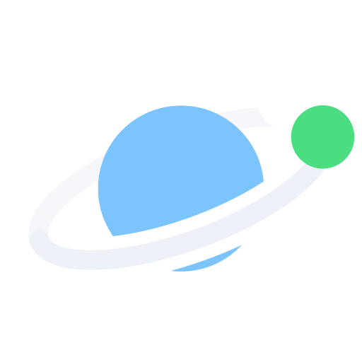
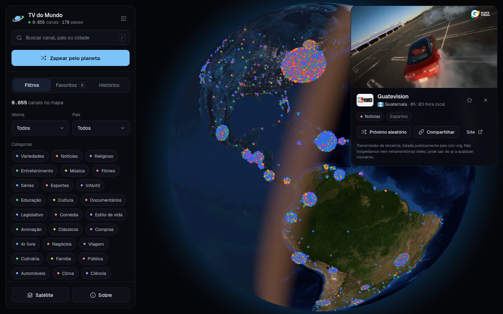
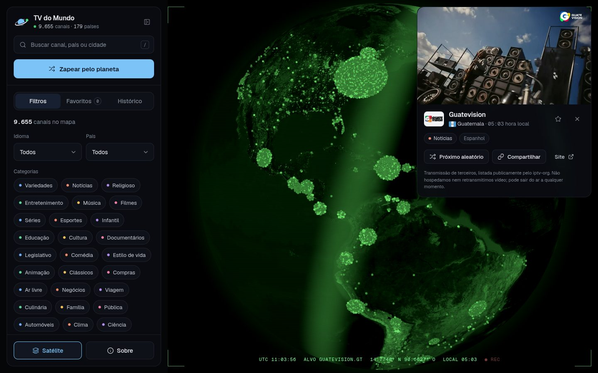
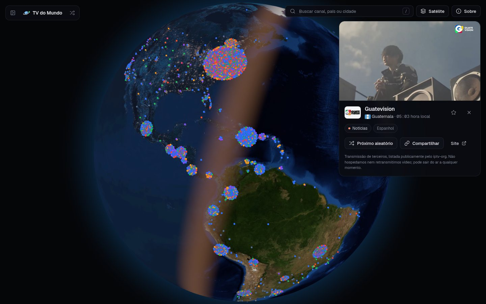
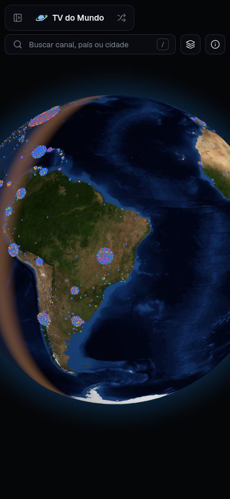
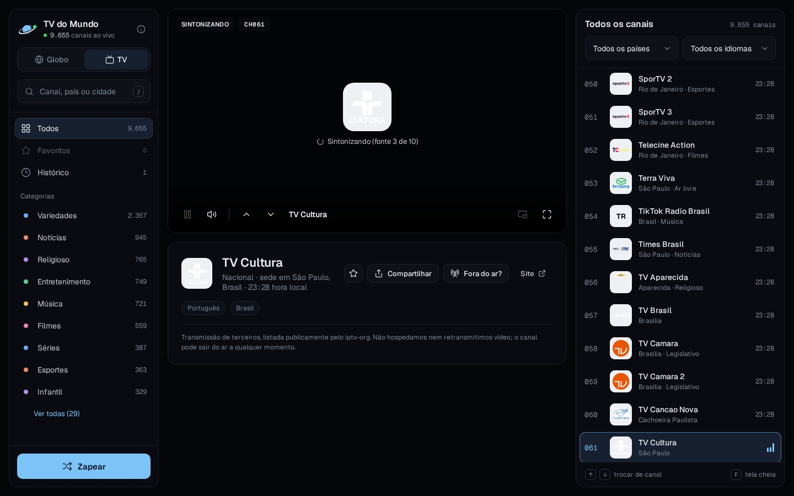
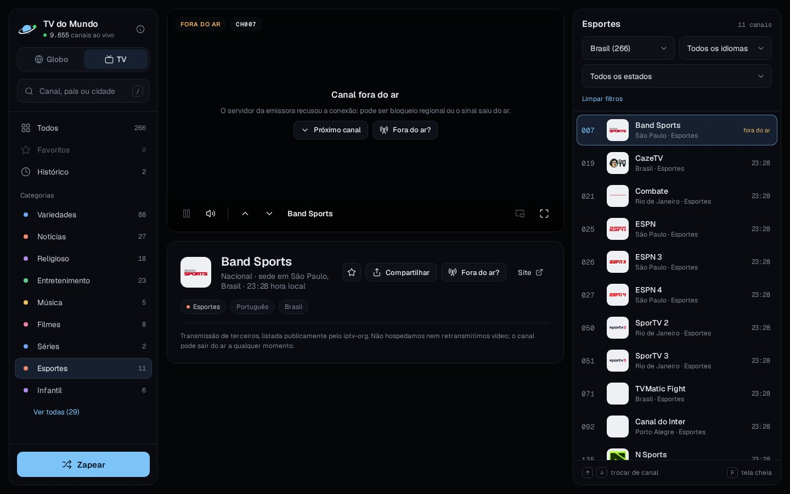
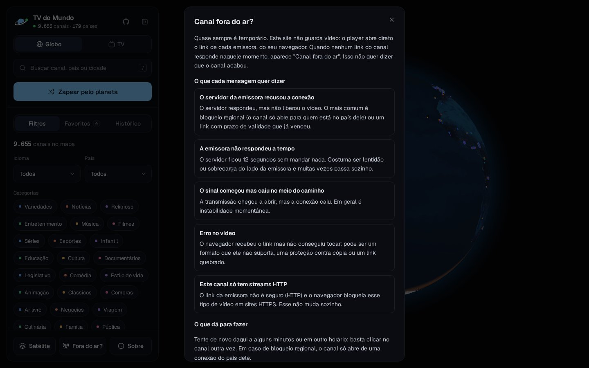
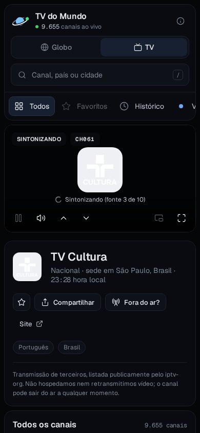

<p align="center">
  
</p>

<h1 align="center">TV do Mundo</h1>

<p align="center">
  Gire o planeta, clique num ponto e assista à TV aberta daquele lugar, ao vivo.
</p>

<p align="center">
  <a href="https://tv-do-mundo.probuled.workers.dev/"><strong>Acessar o TV do Mundo</strong></a>
  ·
  <a href="https://github.com/probuled/tv-do-mundo/releases">Versões</a>
  ·
  <a href="CHANGELOG.md">Changelog</a>
</p>

<p align="center">
  <a href="https://github.com/probuled/tv-do-mundo/actions/workflows/ci.yml"></a>
  <a href="https://github.com/probuled/tv-do-mundo/releases"></a>
  <a href="LICENSE"></a>
</p>



O TV do Mundo é um globo 3D no navegador em que cada canal de TV aberta ao vivo é um ponto de luz. São cerca de
9.600 canais de 179 países. Clique num ponto para assistir na hora, ou aperte **Zapear pelo planeta** e deixe o
globo viajar sozinho de canal em canal. Se preferir algo mais parecido com uma TV de verdade, troque para o
**Modo TV**: uma grade de canais numerados, com a tela no meio e o controle remoto no teclado.

**Em produção:** [tv-do-mundo.probuled.workers.dev](https://tv-do-mundo.probuled.workers.dev/), hospedado no
Cloudflare. A versão publicada é sempre a da branch `main`.

## O que dá para fazer

- **Assistir a qualquer canal do mapa.** O globo voa até o canal, que começa a tocar no player ao lado, com a
  bandeira, a cidade e a hora local de onde ele transmite.
- **Zapear pelo planeta.** O app sorteia um canal a cada intervalo (10, 25, 45 ou 90 segundos) e voa até ele. Se um
  canal estiver fora do ar, ele pula sozinho para o próximo.
- **Ver o dia e a noite de verdade.** O lado escuro do globo segue a posição real do Sol, com as luzes das cidades.
- **Filtrar.** Por categoria (notícias, esportes, música, infantil e outras), idioma e país. A cor de cada ponto é a
  da categoria, então os chips do painel funcionam como legenda do mapa.
- **Buscar.** Por nome do canal, país ou cidade, com o atalho `/`.
- **Guardar.** Favoritos e histórico ficam salvos no navegador, e cada canal tem um link para compartilhar.
- **Entender por que um canal não abre.** O botão **Fora do ar?** explica cada mensagem de erro do player (bloqueio
  regional, link vencido, servidor lento, formato que o navegador não toca) e mostra que, na maioria das vezes, a
  falha é temporária.
- **Ligar o visual Satélite.** Visão noturna verde, linhas de varredura e uma faixa de telemetria com o horário UTC,
  as coordenadas e a hora local do canal.

| Visual Satélite                                                             | Painel recolhido                                                                   |
| --------------------------------------------------------------------------- | ---------------------------------------------------------------------------------- |
|  |  |

<p align="center">
  
  <br />
  <sub>No celular, o painel vira uma gaveta e o player abre embaixo.</sub>
</p>

## Modo TV

Além do globo, os canais podem ser vistos como numa TV. Use a troca **Globo | TV** no topo do painel (ou na barra do
painel recolhido). A escolha fica salva no navegador.



- **Canais numerados.** Cada canal tem um número fixo, como numa TV: o Brasil abre a numeração, com as redes
  nacionais primeiro, e depois vêm os outros países em ordem alfabética. O número não muda com os filtros.
- **Navegação à esquerda.** Busca, Favoritos, Histórico e as categorias com a contagem de canais.
- **Lista à direita.** Filtros por país, idioma e estado, com o logo, a cidade, a categoria e a hora local de cada
  canal. O canal que está tocando fica destacado.
- **A tela no meio.** Mostra **AO VIVO** e o número do canal, com controles próprios: pausar, som, canal anterior e
  próximo, janela flutuante e tela cheia. Quando um canal falha, a própria tela oferece o próximo canal e a
  explicação do erro.
- **Controle remoto no teclado.** As setas trocam de canal, digitar um número (por exemplo `25`) leva direto ao canal
  e `F` abre a tela cheia.

| Categoria e país escolhidos                                                                            | Janela "Fora do ar?"                                                                |
| ------------------------------------------------------------------------------------------------------ | ----------------------------------------------------------------------------------- |
|  |  |

<p align="center">
  
  <br />
  <sub>No celular, o modo TV vira uma coluna só: navegação, tela, informações e lista.</sub>
</p>

### Atalhos

| Tecla | Ação                |
| ----- | ------------------- |
| `/`   | Buscar              |
| `Z`   | Zapear pelo planeta |
| `R`   | Canal aleatório     |
| `V`   | Visual Satélite     |
| `Esc` | Fechar o player     |

No modo TV:

| Tecla     | Ação                      |
| --------- | ------------------------- |
| `↑` `↓`   | Canal anterior e próximo  |
| `0` a `9` | Digitar o número do canal |
| `F`       | Tela cheia                |

## Como funciona

**De onde vêm os canais.** Da lista pública do [iptv-org](https://github.com/iptv-org/iptv), mantida pela
comunidade. O script `scripts/build-data.ts` baixa a API deles e filtra o que o navegador consegue tocar: saem os
streams que exigem cabeçalhos especiais, os canais adultos e os encerrados.

**Onde fica cada ponto.** O iptv-org não tem coordenadas. Cada canal é posicionado pela área de transmissão
informada na lista, na ordem cidade, estado e país, com coordenadas do [Wikidata](https://www.wikidata.org). Hoje
631 canais ficam na cidade, 339 no estado e o restante na capital do país, espalhados numa espiral para não ficarem
empilhados.

**Como o vídeo toca.** O site **não hospeda nem retransmite vídeo**: o player ([hls.js](https://github.com/video-dev/hls.js))
toca a URL original de cada emissora, direto no navegador de quem assiste. Ele tenta cada fonte do canal, começando
pelas que passaram no teste de funcionamento, e avisa quando nenhuma responde em 12 segundos.

**HTTPS.** Em produção o site roda em HTTPS, e o navegador bloqueia streams HTTP nessas páginas. O app detecta isso
e usa só fontes HTTPS: cerca de 85% dos canais têm pelo menos uma. Os outros não aparecem no mapa publicado, mas
tocam quando o projeto roda localmente.

**O globo.** [globe.gl](https://github.com/vasturiano/globe.gl) sobre three.js, com um shader próprio para o dia e
a noite e uma camada própria de pontos: os cerca de 9.600 canais são desenhados de uma vez, e os do outro lado do
planeta somem.

## Rodando localmente

Requer Node.js 24.

```sh
npm install
npm run dev        # http://localhost:5173
```

Ou com Docker (nginx servindo o build):

```sh
docker compose up -d --build   # http://localhost:8080
```

A imagem de cada versão também fica publicada em `ghcr.io/probuled/tv-do-mundo`.

### Atualizando os canais

Os dados já vêm em `public/data/channels.json`. Para gerar de novo a partir do iptv-org:

```sh
npm run check      # opcional: testa todos os streams (10 a 50 minutos)
npm run data       # baixa a lista, geolocaliza e gera o JSON
```

Os downloads ficam em cache na pasta `.cache/`. Apague-a para buscar dados novos.

### Scripts

| Comando             | O que faz                       |
| ------------------- | ------------------------------- |
| `npm run dev`       | Servidor de desenvolvimento     |
| `npm run build`     | Build de produção em `dist/`    |
| `npm run lint`      | oxlint                          |
| `npm run typecheck` | Checagem de tipos do TypeScript |
| `npm test`          | Testes com Vitest               |
| `npm run format`    | Formata o código com Prettier   |

## Estrutura

```
scripts/build-data.ts     API do iptv-org + coordenadas do Wikidata -> public/data/channels.json
scripts/check-streams.ts  teste de todos os streams -> .cache/health.json
src/globe/GlobeView.tsx   globo, shader de dia e noite e a camada de pontos dos canais
src/ui/Sidebar.tsx        painel lateral e a barra do painel recolhido
src/ui/Player.tsx         player do globo
src/ui/useChannelStream.ts  tentativa de cada fonte do canal e o modo zapear (usado pelos dois players)
src/ui/TvGuide.tsx        modo TV: navegação, lista de canais numerados e o controle remoto no teclado
src/ui/TvPlayer.tsx       tela do modo TV, com controles próprios e as informações do canal
src/ui/Search.tsx         busca de canais
src/search.ts             índice de busca, compartilhado pela busca e pelo modo TV
src/tv.ts                 numeração dos canais e a lista do modo TV
src/ui/Overlays.tsx       telemetria do visual Satélite e tooltip
```

## Contribuindo

O projeto usa Git Flow e Conventional Commits, com as regras em [`CLAUDE.md`](CLAUDE.md). Em resumo: todo trabalho
sai da `develop` numa branch `<tipo>/APP-<n>-<descricao>`, os commits seguem Conventional Commits em português, e
tudo entra por pull request com os checks `ci`, `pr-title` e `commitlint` passando. Cada release vai para a `main`
com uma tag `vX.Y.Z`, e é a `main` que está em produção.

## Créditos

- Canais: [iptv-org/iptv](https://github.com/iptv-org/iptv) (CC0 / Unlicense)
- Coordenadas: [Wikidata](https://www.wikidata.org) (CC0)
- Imagens da Terra: NASA Blue Marble e Black Marble (domínio público), via exemplos do
  [three-globe](https://github.com/vasturiano/three-globe)
- Globo: [globe.gl](https://github.com/vasturiano/globe.gl) (MIT) · player: [hls.js](https://github.com/video-dev/hls.js)
  (Apache-2.0)
- Ícones: [Lucide](https://lucide.dev) (ISC) · fontes: [Geist](https://vercel.com/font) (SIL OFL) · bandeiras:
  [flag-icons](https://github.com/lipis/flag-icons) (MIT)
- Inspiração do visual Satélite: [bilawalsidhu/gods-eye-view](https://github.com/bilawalsidhu/gods-eye-view) (MIT).
  Os efeitos daqui são uma versão própria e simplificada em CSS, sem código copiado.

Os canais são de terceiros e podem sair do ar a qualquer momento. Canais adultos ficam de fora.

## Licença

Código sob a licença [MIT](LICENSE). Os canais, as coordenadas e as imagens seguem as licenças das fontes listadas
em Créditos.
